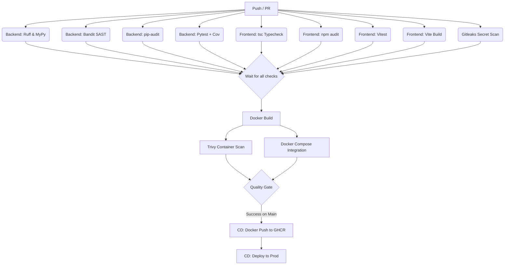

# CI/CD Pipeline Documentation

This repository implements a complete DevSecOps CI/CD pipeline using GitHub Actions, inspired by best practices in shift-left security.

## Pipeline Architecture

## Stage-by-stage Explanation

1. **Linting & Formatting**: We use `ruff` for the backend (replacing black/flake8 for speed) and `tsc` for the frontend.
2. **SAST & Deps**: `bandit` checks Python code for security flaws. `pip-audit` and `npm audit` prevent supply-chain vulnerabilities.
3. **Unit Tests**: `pytest` and `vitest` run test suites. Backend requires 80% coverage to pass.
4. **Secret Scanning**: `gitleaks` scans the repository history to ensure no secrets (e.g. `SECRET_KEY`) are committed.
5. **Docker Build**: Builds both backend and frontend images using multi-stage builds.
6. **Container Scanning**: `trivy` scans the built Docker images. Fails if HIGH or CRITICAL vulnerabilities are found.
7. **Integration Test**: Uses `docker compose` to bring up MongoDB, Backend, and Frontend. Runs `curl` checks on `/health` and `/` to verify they can talk to each other.
8. **Quality Gate**: A final job that aggregates the success of all jobs. If this passes, the PR is mergeable.
9. **CD Pipeline**: Once merged to `main`, the CD pipeline re-tags the images and pushes them to GitHub Container Registry (ghcr.io), ready for deployment.

## Required Secrets / Variables

To make this pipeline run, you must add the following to your GitHub Repository Secrets/Variables:

| Name | Type | Purpose | Example |
|------|------|---------|---------|
| `GITHUB_TOKEN` | Automatically provided by GH | Used by Gitleaks and Docker push. | `ghp_...` |

*Note: Since the app uses environment variables (e.g. `SECRET_KEY`), these are not needed during the CI build process because tests either mock them or use default throwaway values in tests.*

## How to run checks locally

- **Backend Lint**: `python -m ruff check attendance-backend`
- **Backend Types**: `python -m mypy attendance-backend/app`
- **Backend Tests**: `cd attendance-backend && python -m pytest`
- **Frontend Tests**: `cd attendance-frontend && npm run test`
- **Frontend Build**: `cd attendance-frontend && npm run build`
- **Pre-commit**: Install pre-commit (`pip install pre-commit`) and run `pre-commit install`.

## Troubleshooting

- **Gitleaks failed**: If you accidentally committed a secret, rotate the credential immediately. Then rewrite git history (using BFG or `git filter-repo`) or add it to `.gitleaksignore` if it's a false positive test key.
- **Trivy failed**: If the base image has a vulnerability, update the `FROM` line in the Dockerfile to a newer version (e.g., `python:3.13-slim-bookworm` or alpine). Or update the affected package.
- **Pytest coverage failed**: Ensure you have written tests for any new features to keep the total line coverage above 80%.
